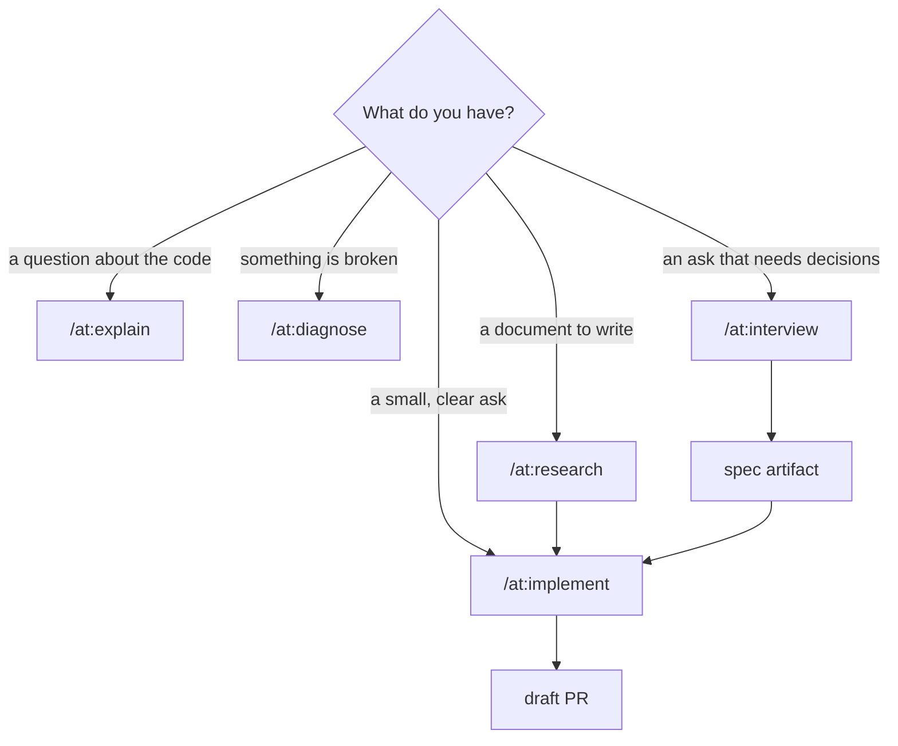

# claude

A Claude Code harness for any repo, language and toolset: operating rules, a clean-code standard, and a plugin named `at` that holds the skills, agents and the clean-code gate. Every skill runs as `/at:<skill>`, so none of them collide with other skills.

It assumes only Claude Code, git, `uv` and `python3`. Every other tool is optional: `rules/environment.md` names each capability (tracker, code host, CI, docs, publish, questions, code search), the tools that can provide it, and the fallback when none is present. On Windows, install Git Bash; the scripts and hooks are bash and Python.

## Install, update, remove

Requires `uv` and `python3`.

The gate is a uv script. It pins its dependencies exactly and has a lockfile beside it (`gate.py.lock`) with the hash of every package. After changing its dependencies, run `uv lock --script at/hooks/clean-gate/gate.py` and commit the lockfile.

```sh
./install.sh                        # installs or updates everything
./install.sh --rules-in claude-md   # puts the operating rules in CLAUDE.md instead
./uninstall.sh                      # removes everything
```

Both scripts install to the config directory: `$CLAUDE_CONFIG_DIR`, or `.claude` in your home directory when it is not set. By default the operating rules go to `rules/operating.md`. Claude Code loads every file in the user `rules/` directory in every session, so your own `CLAUDE.md` stays yours. With `--rules-in claude-md`, install backs up `CLAUDE.md` once and replaces it; a later default install or `uninstall.sh` restores it from that backup. Install backs up `settings.json` once. Run `/reload-plugins` in open Claude Code sessions or start a new one, then run `claude plugin list` and look for `at@skills-dir … loaded`. To change anything, edit it here and run `./install.sh` again. Skills and agents of your own in the config directory are left alone.

If your repos need gitignored files such as `.env` to build, list them in a `.worktreeinclude` file at the repo root (`.gitignore` syntax). Claude Code copies them into every worktree it creates, so worktrees start ready to build.

## How it fits together

| Layer | Installed to | Loaded | What it does |
| --- | --- | --- | --- |
| `global/CLAUDE.md` | `rules/operating.md` (or `CLAUDE.md`) | Every session | How to work and report: scope, evidence, done means checks pass, one PR per ask (one per ticket), finish without stopping, short replies |
| `rules/environment.md` | `rules/` | Every session | Which tool provides each capability, and the fallback when none is present |
| `rules/clean-code.md` | `rules/` | Every session | How to write code: reuse first, match the neighbours, small units, plain names, few comments |
| `rules/writing.md` | `rules/` | Every session | How to write text: Simplified Technical English, no extra words, the PR and ticket formats |
| `at/` plugin | `skills/at/` | Skills on demand; hooks always | The skills below, the `at:worker` agent, the clean-gate hooks that check every edit, the zsh-guard hook that blocks Bash commands zsh runs differently, the pr-checks hook that stops Claude from ending a turn while a PR it opened has checks running or red, and the sync hook that pulls at session start |

Claude can start `/at:survey`, `/at:diagnose`, `/at:explain`, `/at:code-review`, `/at:tests`, `/at:research` and `at:glossary` on its own when they fit. They are the skills other skills call, and a skill that has `disable-model-invocation` cannot be called by another skill. `/at:implement`, `/at:interview`, `/at:postmortem`, `/at:word-salad` and `/at:cone-of-shame` run only when you type them.

## Pick the skill



## Skills

| Skill | Use it when | You get |
| --- | --- | --- |
| `/at:interview` | The ask is part of a bigger problem, or needs decisions | A published spec covering what the ask didn't mention |
| `/at:research` | You need a one-pager (`--one-pager`), PRD (`--prd`) or design doc (`--design`) | A published document |
| `/at:explain` | You want to know how something works, with `as: table \| list \| diagram \| prose \| doc` | An answer with file and line evidence |
| `/at:diagnose` | Something is broken, failing or slow, or you have a CI build or PR URL and ask why | The cause with evidence, then a fix with a regression test |
| `/at:postmortem` | The session repeated friction | A brief for `/at:implement` that fixes this config |
| `/at:survey` | Before writing code: what exists, what to reuse, what to copy | A short reuse map |
| `/at:implement` | A brief or spec is ready to build | A draft PR |
| `/at:code-review` | A branch needs a bug review of its whole diff; `/at:implement` runs it for you. Add a spec path to check the diff against it | One line per bug, a second list against the spec, and a count of the files it read |
| `/at:tests` | Before writing or changing a test; `audit [path]` to audit a whole suite | Tests that can fail and run alone; an audit brief for `/at:implement` |
| `/at:word-salad` | A reply is too dense to read | The same content in plain, short, ordered prose |
| `/at:cone-of-shame` | A response broke the rules or was bad. Add a note on what went wrong | The work redone, and a draft PR that fixes the cause in this config |

## Getting the best results

- **Start from a file, not a paragraph.** Skills read a brief or spec by path. A small, clear ask goes straight to `/at:implement`. Anything with a design choice goes through `/at:research` or `/at:interview` first.
- **Let size set effort, not worry.** Raise effort only after a run fails for lack of it, one level at a time. Skills run on your session model.
- **Survey before you build.** `/at:implement` does this for you, but for work in your own session, run `/at:survey <what you're adding>` first.
- **Read gate findings like review comments.** Fix each one, or say why it's intended. Tune each repo with a `.clean-gate.json` (below).
- **Judge the PR by its first two paragraphs.** Every PR opens with one paragraph on what the code does now and one on what changes, three sentences or fewer each, then "Reviewer notes" with its "Merge danger" line. If you can't follow them, ask for a rewrite before reading the code.
- **Done means the checks ran.** The PR carries each command and its exit code. A summary that says "tests pass" without output isn't done.
- **Too much to read?** Run `/at:word-salad` with no argument to rewrite the last reply, or pass it text or a file path.
- **One ask per session.** Start a new session between unrelated tasks, so old context doesn't steer the new one.

## Glossary and decision records

The `glossary` skill keeps a glossary and decision records for each repo in `~/at-skills-data/<host>/<org>/<repo>/`, taken from the `origin` remote, so no repo holds them. `/at:interview`, `/at:diagnose`, `/at:explain` and `/at:research` read them first. `/at:interview` and `/at:diagnose` add terms. `~/at-skills-data` is a local git repo with no remote, and each write is a commit. `uninstall.sh` never touches it.

## A PR is done when its checks pass

The `at/hooks/pr-checks/pr_checks.py` Stop hook works with the GitHub CLI. It reads the session transcript for PR links that the CLI's create command printed. Before Claude ends a turn, it reads the checks of each one. If a check is running, failed or was cancelled, the hook blocks the stop and names the checks, so Claude waits and fixes the cause. It blocks once in a row: the next stop goes through, so it cannot loop. Without the GitHub CLI on PATH, the hook does nothing.

## Start from the latest code

At session start, the `at/hooks/sync/sync.sh` hook fetches the remote and fast-forwards the current branch. `at/scripts/default-branch.sh` finds the remote (`origin`, then the branch's upstream remote, then the only remote) and its default branch. On a feature branch, it also tells Claude to merge the default branch when that branch has commits from more than 3 hours ago that the feature branch lacks. It never merges or overwrites work itself: a branch that cannot fast-forward is reported, not changed.

## The clean-code gate

The gate runs after every edit, including in agent sessions, since those write code too. It sends its findings back to Claude, which fixes them before carrying on.

| Check | Rule |
| --- | --- |
| Size | A new function has at most 30 lines, complexity 10 and 3 parameters |
| Ratchet | A changed function that was already over a limit may not grow; untouched code is never reported |
| Repeated name | A new function's name isn't already defined in another tracked file |
| Comment run | No added comment longer than 3 lines, except a header at line 1 |

[lizard](https://github.com/terryyin/lizard) reads functions in 26 languages. In a language lizard can't read, only the comment check runs.

An optional `.clean-gate.json` at a repo root changes the defaults for that repo:

```json
{
  "limits": { "nloc": 30, "ccn": 10, "params": 3, "commentRun": 3 },
  "ignoreNames": ["main", "__init__", "constructor", "App"],
  "ignorePaths": ["**/generated/**"]
}
```

To measure a branch, including files edited through Bash, which the edit hook does not see: `uv run --script "${CLAUDE_CONFIG_DIR:-$HOME/.claude}/skills/at/hooks/clean-gate/gate.py" report <default branch>..HEAD`

## Tests

```sh
uv run --no-project --with pytest==9.1.1 --with lizard==1.24.1 pytest -q tests
bash tests/test_install.sh
bash tests/test_glossary_path.sh
bash tests/test_sync.sh
bash tests/test_default_branch.sh
bash tests/test_neutral.sh
uvx ruff@0.16.10 check at tests && uvx ruff@0.16.10 format --check at tests
claude plugin validate at
shellcheck -x install.sh uninstall.sh at/hooks/sync/sync.sh at/skills/glossary/path.sh at/scripts/default-branch.sh tests/test_install.sh tests/test_sync.sh tests/test_glossary_path.sh tests/test_default_branch.sh tests/test_neutral.sh
```
